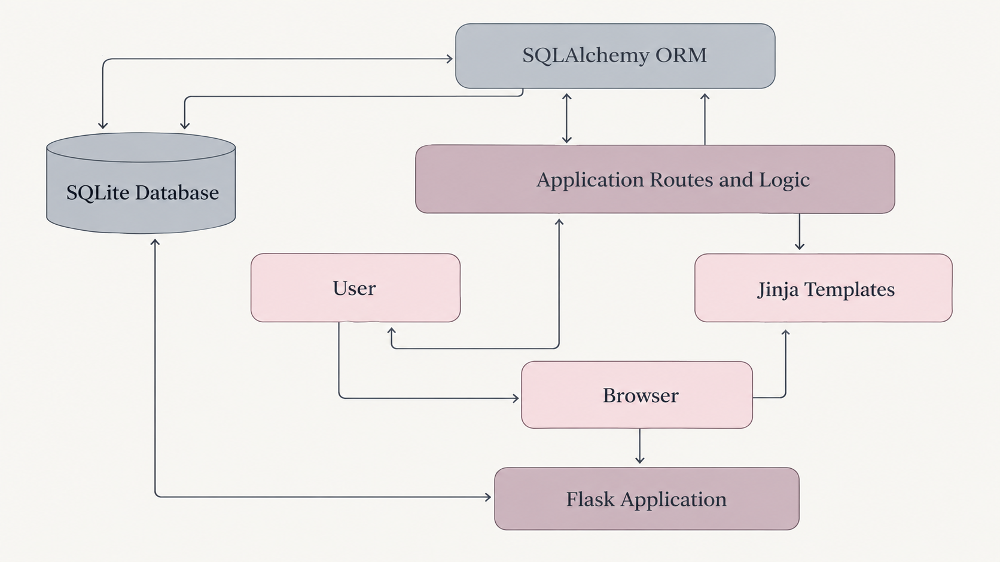

# Art Idea Organizer & Archive

A web application for organizing, managing, and exploring creative ideas. Art Idea Organizer provides a centralized space to document project concepts, organize collections, track artistic mediums, create color palettes, and save visual references.

## Features

- **Idea Management** — Create, edit, view, and delete art ideas, with support for titles and descriptions.
- **Collections** — Organize related ideas into collections and manage their associations.
- **Mediums** — Associate ideas with different artistic mediums.
- **Color Palettes** — Create and manage color palettes to accompany creative projects.
- **Reference Images** — Store visual references alongside ideas.
- **Search and Filtering** — Find ideas using search criteria and filters, including title, description, medium, collection, and color.
- **Database Management** — Use SQLAlchemy for database operations and Flask-Migrate for tracking database schema changes.

## Architecture

The application follows a modular Flask architecture, separating request handling, database models, and application logic into distinct components.

<p align="center">
  
</p>

For a more detailed explanation of the application structure and component interactions, see the [Architecture Documentation](docs/architecture/README.md).

## Technologies

- **Python** — Application programming language.
- **Flask** — Web application framework.
- **SQLAlchemy** — Database ORM.
- **Flask-Migrate / Alembic** — Database schema migrations.
- **SQLite** — Default database.
- **HTML, CSS, JavaScript** — Frontend development.
- **Jinja** — Server-side HTML templating.
- **pytest** — Automated testing.

## Getting Started

For installation instructions, environment configuration, database setup, and steps to run the application locally, see the [How to Run](docs/README.md) guide.

## Development Status

<badge color="info">In Development</badge>

Art Idea Organizer is an active development project. Core application functionality is being implemented and refined, with ongoing work focused on improving features, testing application behavior, and refining the overall user experience.

Deployment is planned for a future release. In the meantime, the application can be run locally by following the [How to Run](docs/README.md) guide.

## Testing

The project includes unit and integration tests written with `pytest`.

To run the full test suite from the project root directory:

```bash
pytest
```

For more information about the test organization and available commands, see the [Tests Documentation](tests/README.md).

## Project Structure

```text
.
├── app/
│   ├── models/
│   ├── routes/
│   ├── services/
│   ├── static/
│   └── templates/
├── docs/
│   ├── architecture/
│   └── database/
├── migrations/
├── tests/
│   ├── integration/
│   └── unit/
├── config.py
└── ...
```