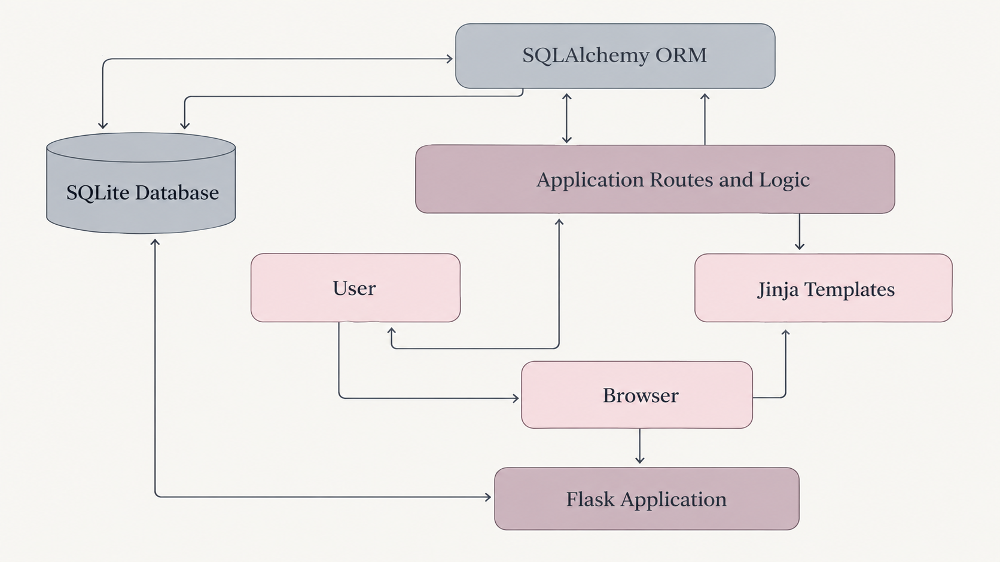

# Application Architecture

## Overview

The application follows a modular, server-rendered web architecture built with Flask. It uses a relational SQLite database, accessed through SQLAlchemy, to store and manage creative ideas and their associated organizational data.

The application separates its main responsibilities into three areas: the presentation layer, application layer, and data layer. This separation helps keep the interface, application functionality, and database operations organized and maintainable.

## Architecture Diagram

## Architectural Layers

### Presentation Layer

The presentation layer is responsible for displaying application content and handling user interactions. It consists of HTML templates rendered through Jinja, CSS for styling and layout, and JavaScript for client-side interactions.

Users interact with this layer to create and edit ideas, browse the archive, manage collections and artistic mediums, and search or filter existing entries.

### Application Layer

The application layer is built with Flask and handles incoming HTTP requests, application functionality, and communication between the presentation and data layers.

It processes user-submitted forms, coordinates create, read, update, and delete (CRUD) operations, and retrieves the information needed to render application pages. It also handles archive search and filtering based on user-supplied criteria.

### Data Layer

The data layer uses SQLite for persistent storage and SQLAlchemy as the Object-Relational Mapping (ORM) framework.

It manages the application's relational data, including creative ideas and their associated collections, mediums, and other organizational information. SQLAlchemy provides the interface between the application's Python code and the underlying database.

## Technology Stack

| Component | Technology | Responsibility |
|---|---|---|
| Backend | Python, Flask | Request handling and application logic |
| Database | SQLite | Persistent data storage |
| ORM | SQLAlchemy | Database models and queries |
| Frontend | HTML, Jinja | Page structure and server-side rendering |
| Styling | CSS | Layout and visual presentation |
| Client-side scripting | JavaScript | Interactive behavior |
| Testing | pytest | Automated application testing |
| CI/CD | GitHub Actions | Automated testing workflows |

## Request Flow

The application follows a request-response cycle:

1. A user interacts with the application through a web browser.
2. Flask receives the incoming HTTP request.
3. The application processes the request and executes the relevant logic.
4. SQLAlchemy communicates with the SQLite database when data needs to be retrieved or modified.
5. Flask passes the resulting data to the appropriate Jinja template.
6. The rendered HTML is returned to the browser.

For example, when a user creates a new idea, the submitted form is processed by Flask, the application validates and handles the submitted information, and SQLAlchemy stores the new record in SQLite. The application then returns the appropriate page to the user.
