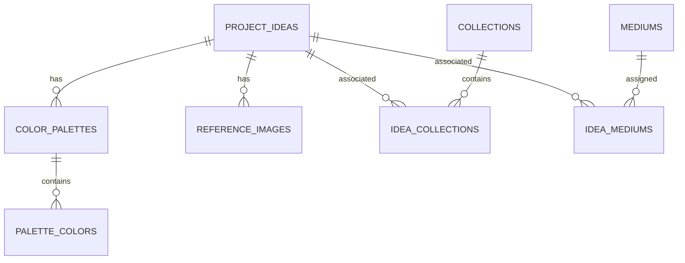

# Database Schema Overview

## Overview

The application uses **SQLite** as its relational database and **SQLAlchemy ORM** for database modeling and interaction. The schema is centered around the `ProjectIdea` entity, which represents an individual art idea.

Each idea can be organized into collections, associated with one or more art mediums, and supplemented with color palettes and reference images. The database uses primary keys, foreign keys, and association tables to maintain these relationships.

## Database Structure

The database consists of six primary tables and two association tables.

| Table | Description |
|---|---|
| `project_ideas` | Stores art ideas, including their titles, descriptions, and timestamps. |
| `collections` | Stores named collections used to organize ideas. |
| `mediums` | Stores reusable art mediums that can be assigned to ideas. |
| `color_palettes` | Stores named color palettes associated with individual ideas. |
| `palette_colors` | Stores the individual hexadecimal colors within each palette. |
| `reference_images` | Stores external image URLs and captions associated with ideas. |
| `idea_collections` | Association table connecting ideas and collections. |
| `idea_mediums` | Association table connecting ideas and mediums. |

## Entity Relationships

`project_ideas` is the central table in the schema. Its relationships with the other entities are structured as follows:

- **Ideas and Collections — Many-to-Many:** An idea can belong to multiple collections, and a collection can contain multiple ideas. This relationship is managed through `idea_collections`.
- **Ideas and Mediums — Many-to-Many:** An idea can have multiple mediums, and a medium can be associated with multiple ideas. This relationship is managed through `idea_mediums`.
- **Ideas and Color Palettes — One-to-Many:** An idea can have multiple color palettes, while each palette belongs to one idea.
- **Color Palettes and Palette Colors — One-to-Many:** A palette can contain multiple individual colors, while each color belongs to one palette.
- **Ideas and Reference Images — One-to-Many:** An idea can have multiple reference images, while each reference image belongs to one idea.

## Entity Relationship Diagram

The following diagram illustrates the database structure and the relationships between its tables.

## Data Integrity

The schema uses relational constraints to maintain consistency between records:

- Primary keys uniquely identify records within each table.
- Foreign keys establish relationships between related tables.
- Unique constraints prevent duplicate names for collections and mediums.
- NOT NULL constraints ensure required fields contain values.
- Composite primary keys prevent duplicate associations in the many-to-many relationship tables.
- Cascading deletion rules are configured for dependent records and association-table entries.

## Model Organization

Database models are organized into separate modules within the `app/models/` directory. Each module defines a specific entity or group of related entities. The package exposes the models through its `__init__.py` file.

For detailed model definitions, including columns, data types, constraints, relationships, and deletion behavior, see [Database Models README](../../app/models/README.md).

